# TusViajes - Kubernetes

Configuración de infraestructura como código (IaC) para desplegar los componentes de **TusViajes** en un clúster de Kubernetes, consumiendo las imágenes públicas de [Docker Hub (rodribolanos)](https://hub.docker.com/u/rodribolanos).

---

## 🏛️ Arquitectura

```mermaid
flowchart LR
    Browser["Navegador\n(localhost:5173)"] --> FE_SVC["Service: frontend\n(LoadBalancer: 5173->80)"]
    FE_SVC --> FE["Pod: frontend\n(React + Nginx)"]
    FE -- "proxy /api/*" --> BE_SVC["Service: backend\n(ClusterIP: 8080)"]
    BE_SVC --> BE["Pod: backend\n(Spring Boot)"]
    BE -- "HTTP :8081" --> FL_SVC["Service: flights-api\n(ClusterIP: 8081)"]
    FL_SVC --> FL["Pod: flights-api\n(Spring Boot)"]
    BE -- "JDBC :5432" --> DB_SVC["Service: postgres\n(ClusterIP: 5432)"]
    FL -- "JDBC :5432" --> DB_SVC
    DB_SVC --> DB["Pod: postgres\n(PostgreSQL 16)"]
```



### Componentes y Puertos

| Componente | Imagen | Service Type | Puerto Interno | Puerto Host |
| :--- | :--- | :--- | :--- | :--- |
| **frontend** | `rodribolanos/pdes-2026c2-frontend:main` | `LoadBalancer` | `80` | `http://localhost:5173` |
| **backend** | `rodribolanos/pdes-2026c2-backend:main` | `ClusterIP` | `8080` | *Interno* |
| **flights-api** | `rodribolanos/pdes-2026c2-externalservice:main` | `ClusterIP` | `8081` | *Interno* |
| **postgres** | `postgres:16-alpine` | `ClusterIP` | `5432` | *Interno* |

---

## 📁 Estructura del Proyecto

```text
kube/
├── configmaps/
│   ├── app-configmap.yaml              # Variables no sensibles (URLs, timezone, DB name)
│   └── frontend-nginx-configmap.yaml   # Configuración de Nginx para proxy inverso (/api/ -> backend)
├── secrets/
│   └── postgres-secret.yaml            # Credenciales de base de datos
├── deployments/
│   ├── postgres-deployment.yaml        # Deployment de PostgreSQL
│   ├── flights-deployment.yaml         # Deployment de Flights API
│   ├── backend-deployment.yaml         # Deployment de TusViajes Backend
│   └── frontend-deployment.yaml        # Deployment de Frontend
├── services/
│   ├── postgres-service.yaml           # Service ClusterIP :5432
│   ├── flights-service.yaml            # Service ClusterIP :8081
│   ├── backend-service.yaml            # Service ClusterIP :8080
│   └── frontend-service.yaml           # Service LoadBalancer :5173
└── README.md
```

---

## 🚀 Despliegue

### Requisitos
* Docker Desktop con **Kubernetes activado** (en estado *Running*).
* `kubectl` configurado en el path.

### Levantar el clúster
```powershell
kubectl apply -R -f .
```

### Verificar estado
```powershell
kubectl get pods,svc
```
Todos los pods deben figurar en estado `Running (1/1)`:
```text
NAME                           READY   STATUS    RESTARTS   AGE
backend-...                    1/1     Running   0          30s
flights-api-...                1/1     Running   0          30s
frontend-...                   1/1     Running   0          30s
postgres-...                   1/1     Running   0          30s
```

### Acceso
Abrir en el navegador: **[http://localhost:5173](http://localhost:5173)**.

---

## 🔧 Decisiones de Diseño

1. **Seguridad y Red (`ClusterIP` vs `LoadBalancer`)**:
   * Solo el frontend se expone fuera del clúster (`type: LoadBalancer` en puerto `5173`).
   * La base de datos y los backends son privados (`type: ClusterIP`), accesibles únicamente dentro de la red interna del clúster.

2. **Configuraciones y Secretos (`ConfigMap` vs `Secret`)**:
   * **`ConfigMap`**: Almacena variables no sensibles (`SPRING_DATASOURCE_URL`, `FLIGHTS_API_BASE_URL`, `JAVA_TOOL_OPTIONS`).
   * **`Secret`**: Almacena credenciales de acceso a la base de datos (`POSTGRES_USER`, `POSTGRES_PASSWORD`), desacoplándolas de los manifiestos de despliegue.

3. **Manejo del Schema `world` en Base de Datos**:
   * `flights-api` es dueño del schema `world` y lo inicializa con Flyway (`V1__init_countries.sql`).
   * Para evitar que Flyway saltee la migración V1 si el backend arranca primero, se configuró `SPRING_FLYWAY_BASELINE_VERSION: "0"` en el deployment de flights.

---

## 📋 Comandos Frecuentes

```powershell
# Ver logs en tiempo real
kubectl logs -f -l app=backend
kubectl logs -f -l app=flights-api
kubectl logs -f -l app=frontend

# Reiniciar un deployment
kubectl rollout restart deployment/backend

# Eliminar todos los recursos del clúster
kubectl delete -R -f .
```
