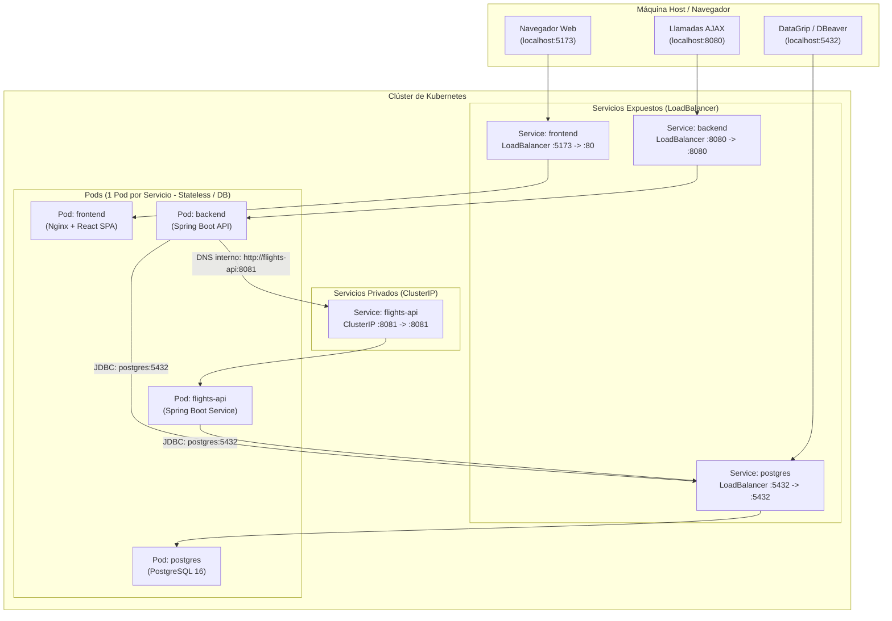

# TusViajes - Kubernetes

Infraestructura declarativa (IaC) para desplegar los servicios de **TusViajes** en un clúster de Kubernetes, consumiendo las imágenes de [Docker Hub (rodribolanos)](https://hub.docker.com/u/rodribolanos).

---

## 🏛️ Arquitectura del Clúster



### Tabla de Servicios y Puertos

| Servicio | Tipo de Service | Puerto Host | Puerto Contenedor | Acceso | Propósito |
| :--- | :--- | :--- | :--- | :--- | :--- |
| **frontend** | `LoadBalancer` | `5173` | `80` | Público (Host) | Web SPA servida por Nginx. |
| **backend** | `LoadBalancer` | `8080` | `8080` | Público (Host) | API REST consumida por el bundle cliente del navegador. |
| **postgres** | `LoadBalancer` | `5432` | `5432` | Público (Host) | Base de datos accesible para DataGrip / DBeaver / tests locales. |
| **flights-api** | `ClusterIP` | *N/A* | `8081` | Interno (Clúster) | Microservicio privado de vuelos, solo consultado por el backend. |

---

## 📁 Estructura del Repositorio

```text
kube/
├── configmaps/
│   ├── app-configmap.yaml              # Variables no sensibles (URLs, timezone, baseline Flyway)
│   └── frontend-nginx-configmap.yaml   # Configuración Nginx (SPA try_files y proxy /api/)
├── secrets/
│   └── postgres-secret.yaml            # Credenciales de BD en base64
├── deployments/
│   ├── postgres-deployment.yaml        # Deployment de PostgreSQL 16
│   ├── flights-deployment.yaml         # Deployment de Flights API (imagePullPolicy: Always)
│   ├── backend-deployment.yaml         # Deployment del Backend (imagePullPolicy: Always)
│   └── frontend-deployment.yaml        # Deployment del Frontend (imagePullPolicy: Always)
├── services/
│   ├── postgres-service.yaml           # Service LoadBalancer :5432
│   ├── flights-service.yaml            # Service ClusterIP :8081 (privado)
│   ├── backend-service.yaml            # Service LoadBalancer :8080
│   └── frontend-service.yaml           # Service LoadBalancer :5173
├── .gitignore                          # Excluye binarios, temporales y documentación privada
└── README.md
```

---

## 🚀 Despliegue y Ejecución

### Prerrequisitos
* Docker Desktop con soporte de **Kubernetes habilitado**.
* `kubectl` disponible en el path de la terminal.

### 1. Aplicar todos los manifiestos
Desde la raíz del repositorio `kube`:
```powershell
kubectl apply -R -f .
```

### 2. Verificar el estado de los recursos
```powershell
kubectl get pods,svc
```
Todos los pods deben reportar `1/1 Running`:
```text
NAME                               READY   STATUS    RESTARTS   AGE
backend-xxxxxxxxxx-xxxxx           1/1     Running   0          45s
flights-api-xxxxxxxxxx-xxxxx       1/1     Running   0          45s
frontend-xxxxxxxxxx-xxxxx          1/1     Running   0          45s
postgres-xxxxxxxxxx-xxxxx          1/1     Running   0          45s
```

### 3. Puntos de Acceso
* **Frontend Web:** [http://localhost:5173](http://localhost:5173)
* **Backend API REST:** [http://localhost:8080/api/countries](http://localhost:8080/api/countries)
* **Base de datos (DataGrip/DBeaver):** `localhost:5432`, base `postgres`, usuario `admin`, clave `password`.

---

## 🎯 Alineación con Conceptos de la Cátedra (PDES - UNQ)

1. **Desacoplamiento de Pods (Slide 10)**:
   * Cada componente corre en su propio Pod y Deployment aislado.
   * Se evita expresamente el antipatrón de agrupar `backend + frontend + broker` dentro de un único Pod, garantizando escalabilidad y ciclo de vida independiente.

2. **Políticas de Actualización (`imagePullPolicy: Always`)**:
   * Las imágenes remotas utilizan el tag móvil `:main` generado por los workflows de CI/CD.
   * Con `imagePullPolicy: Always`, Kubernetes valida contra Docker Hub el digest SHA-256 de la imagen en cada inicio, garantizando ejecutar la última versión publicada.

3. **Resolución por DNS Interno y ClusterIP (Slide 11)**:
   * Los servicios internos no necesitan conocer IPs dinámicas de los Pods. El backend resuelve el servicio de vuelos mediante el hostname automático del clúster: `http://flights-api:8081`.

4. **Separación de Responsabilidades en Configuración (ConfigMaps vs Secrets)**:
   * **ConfigMaps:** Variables operativas del entorno (`SPRING_DATASOURCE_URL`, `JAVA_TOOL_OPTIONS`, `FLIGHTS_API_BASE_URL`).
   * **Secrets:** Credenciales de autenticación (`POSTGRES_USER`, `POSTGRES_PASSWORD`).

5. **Nginx como Servidor Web y SPA Routing**:
   * El frontend está empaquetado como aplicación SPA (Single Page Application). La configuración inyectada por ConfigMap resuelve rutas del lado del cliente (`try_files $uri $uri/ /index.html`), evitando errores 404 al refrescar páginas en rutas internas.

---

## 🔄 Actualización de Imágenes sin Downtime

Cuando se publica una nueva versión de una imagen en Docker Hub bajo el mismo tag (`:main`), se fuerza la descarga y el reinicio progresivo (Rolling Update) mediante:

```powershell
# Reiniciar un servicio específico (ej: backend)
kubectl rollout restart deployment/backend

# Reiniciar todos los servicios de aplicación
kubectl rollout restart deployment/backend deployment/frontend deployment/flights-api

# Seguir el estado del despliegue en vivo
kubectl rollout status deployment/backend
```

---

## 🧹 Comandos Útiles de Mantenimiento

```powershell
# Ver logs en vivo por etiqueta de aplicación
kubectl logs -f -l app=backend
kubectl logs -f -l app=flights-api
kubectl logs -f -l app=frontend

# Desmantelar todos los recursos del clúster
kubectl delete -R -f .
```
